<!-- ───────────────────────── Header ───────────────────────── -->
<p align="center">
  
</p>

<p align="center">
  
</p>

<p align="center">
  <a href="#-see-it-in-action">
    
  </a>
</p>

<p align="center">
  
  
  
  
  <br/>
  
  
  
</p>

<p align="center">
  <b>OSFLOW</b> makes operating systems easy for newcomers.<br/>
  Every concept gets <b>real code</b> on one side and an <b>animation of what the machine is doing</b> on the other,<br/>
  moving together <b>line by line</b>, with a plain-English explanation of every step.
</p>

<p align="center">
  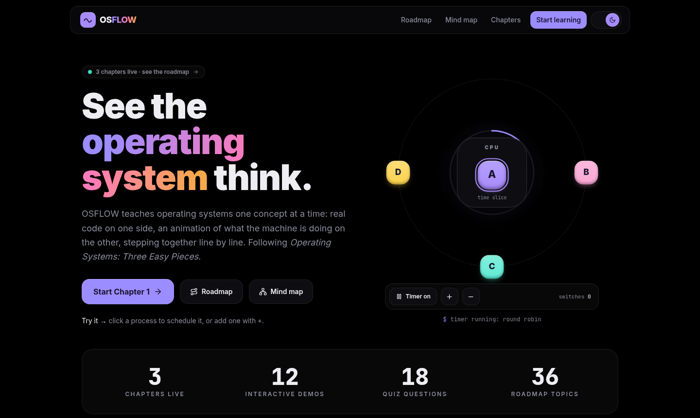
</p>

---

##  Table of contents

1. [Why OSFLOW?](#-why-osflow)
2. [See it in action](#-see-it-in-action)
3. [What you can learn today](#-what-you-can-learn-today)
4. [Roadmap & mind map](#-roadmap--mind-map)
5. [How a lesson works](#-how-a-lesson-works)
6. [Design](#-design)
7. [Getting started](#-getting-started)
8. [Project structure](#-project-structure)
9. [Adding a chapter](#-adding-a-chapter)
10. [Credits](#-credits)

---

##  Why OSFLOW?

Operating-system books show you code and describe what happens, but **you have to picture the machine in your head**. That's the hard part for beginners.

OSFLOW draws that picture for you:

| | |
|---|---|
| 🧾 **Real code** | The classic example programs from *Operating Systems: Three Easy Pieces* (OSTEP), with the running line highlighted |
| 🎞️ **Step-synced animation** | CPU, memory, processes, files and disks react to every line. Play, pause, rewind, scrub, change speed |
| 💬 **Plain-language narration** | Each step says *what* just happened and *why* the OS did it |
| 🎛️ **Things to try** | Switches like *"who runs first?"*, *"unlucky timing"* or *"crash before fsync()"* change the outcome |
| ✅ **Quizzes & progress** | Every chapter ends with a quiz; your score shows on the home page and the roadmap |

---

##  See it in action

### 1. Play with a CPU on the home page

Click a process to schedule it, add one with <kbd>+</kbd>, and watch the timer interrupt hand out time slices.

<p align="center">
  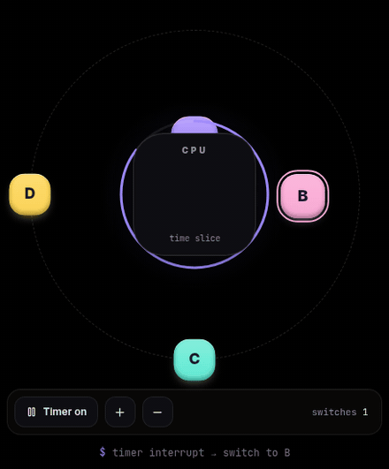
</p>

### 2. One CPU, many programs

Four copies of `cpu.c` share one core. The highlighted line follows whichever process is running, and the terminal shows their output interleaving.

<p align="center">
  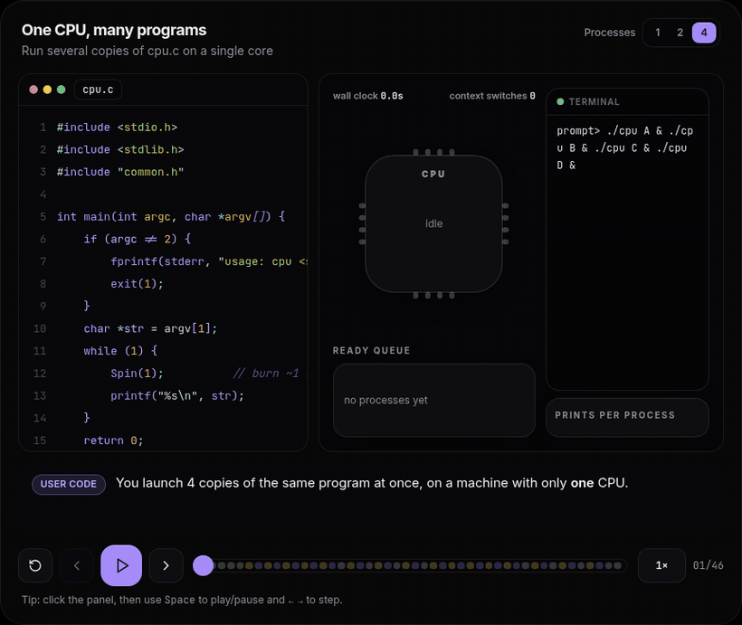
</p>

### 3. A race condition, caught in the act

`counter++` is really **load → add → store**. With *unlucky* timing, two threads overwrite each other: 3 + 3 should be 6, but the result is **4**.

<p align="center">
  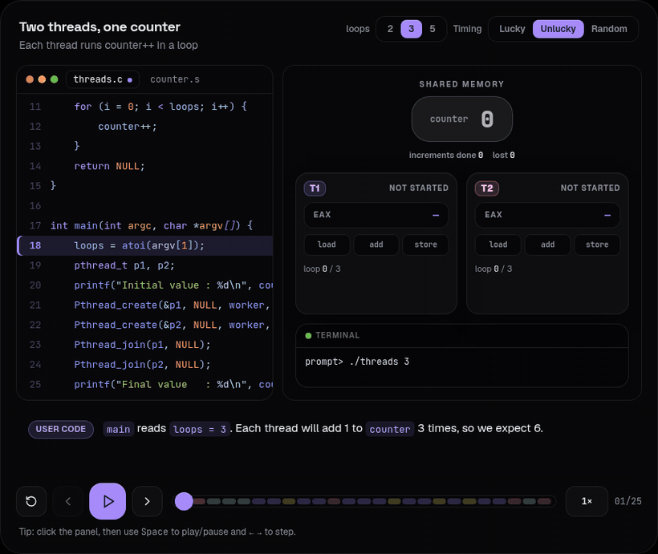
</p>

### 4. `fork()` + `wait()`, with both processes on screen

The <kbd>P</kbd> and <kbd>C</kbd> markers in the gutter show where the **parent** and the **child** are. `fork()` returns twice, the parent blocks in `wait()`, and the child becomes a zombie and gets reaped.

<p align="center">
  
</p>

<details>
<summary><b>📸 More lessons (click to expand)</b></summary>
<br/>

| Same address, different memory | xv6's `struct proc` & a context switch |
|:---:|:---:|
| 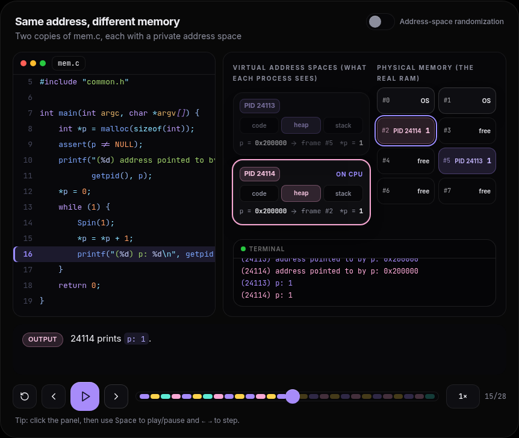 | 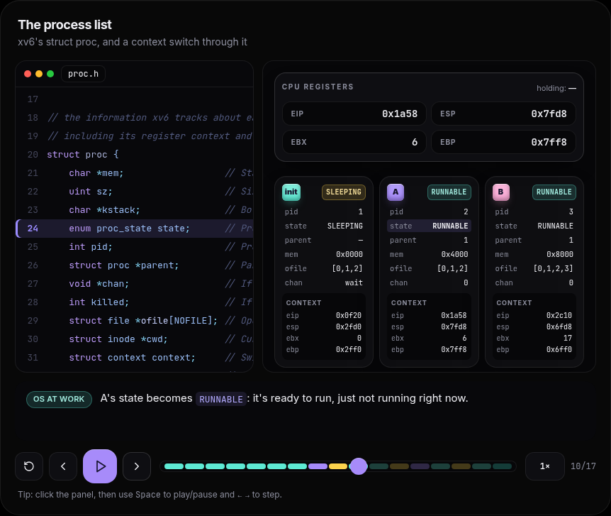 |

<p align="center"><b>How the shell does <code>&gt;</code> redirection</b>: <code>close(1)</code>, <code>open()</code> reuses fd 1, and <code>exec</code> keeps it.</p>
<p align="center">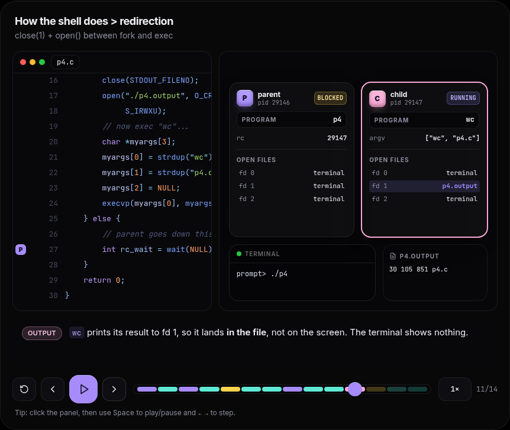</p>

</details>

---

##  What you can learn today

| # | Chapter | OSTEP | Interactive demos |
|:-:|---|:-:|---|
| 1 | **Introduction to Operating Systems** | ch. 2 | fetch → decode → execute · CPU virtualization · virtual memory · thread race · `write` / `fsync` / crash |
| 2 | **The Process** | ch. 4 | program → process loading · Ready / Running / Blocked with trace table · xv6 PCB & context switch |
| 3 | **Process API** | ch. 5 | `fork()` · `wait()` · `exec()` · shell redirection |

Each chapter also covers the theory around the demos: design goals, history, process states, pipes, signals, users. It ends with a **6-question quiz**.

> [!TIP]
> Click a demo, then press <kbd>Space</kbd> to play or pause, <kbd>←</kbd> <kbd>→</kbd> to step, and <kbd>R</kbd> to restart.

---

##  Roadmap & mind map

Two maps of the whole subject, linked to the lessons.

### 🛣️ Learning roadmap (`/roadmap`)

**36 topics in 6 stages**, in OSTEP order, drawn like a roadmap.sh spine. Each topic shows whether its lesson is live, coming soon or planned, and whether it's core or optional. Click a topic to see what you'll learn and jump into its lesson. Below the map, a written guide explains every stage.

<p align="center">
  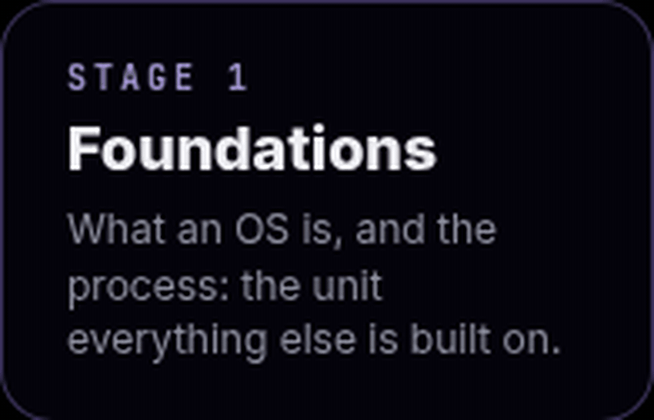
</p>

### 🧠 Concept mind map (`/mindmap`)

**41 concepts around 6 big ideas.** Expand and collapse branches, zoom, drag, and click any concept to read what it means and open the exact lesson section. There's also an outline view for phones and screen readers.

<p align="center">
  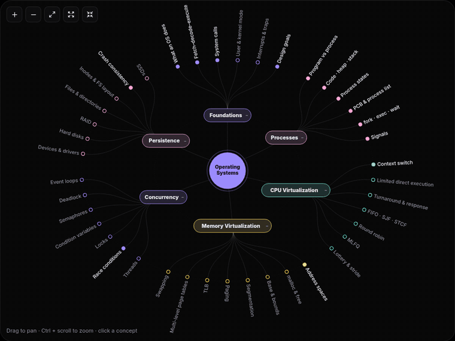
</p>

---

##  How a lesson works

Every demo is a **pure simulator** that returns a list of snapshots. The player just moves through that list, which is why rewind and scrubbing come free and every demo can be unit-tested.

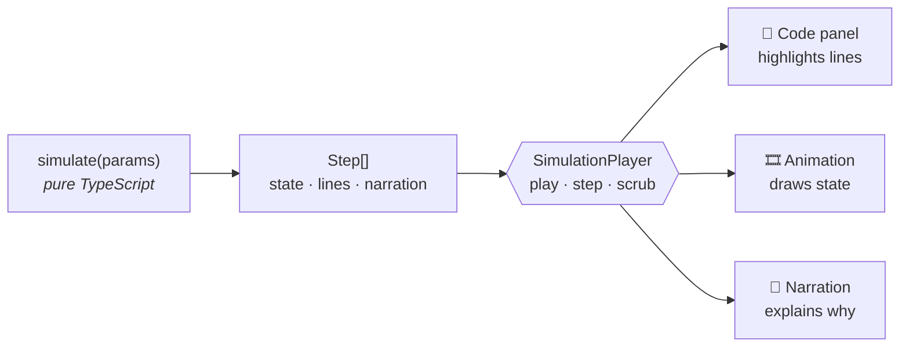

```ts
type Step<S> = {
  file: string;        // which source file
  lines: number[];     // lines to highlight
  state: S;            // full snapshot of the simulated machine
  narration: string;   // plain-language explanation
  cursors?: Cursor[];  // per-process markers (parent / child)
};
```

Source code is syntax-highlighted **at build time** with Shiki, so no highlighter code reaches the browser.

---

##  Design

- **Dark-first** with a pure-black background, plus a light theme
- **Glass** for containers, **clay** only for processes & threads, and flat **tinted** chips for everything else
- **Clean motion**: one ease-out curve, no springs or flashy loops, and respect for *reduce motion*
- **Accessible**: keyboard-driven players, live narration regions, AA contrast, outline views

<p align="center">
  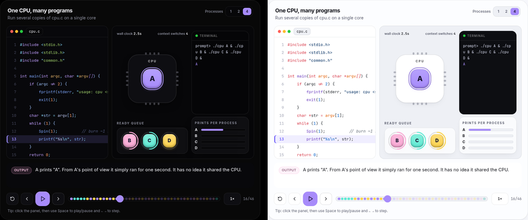
</p>

<p align="center">
  <b>Works on phones</b> 📱<br/><br/>
  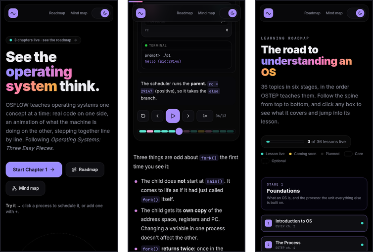
</p>

---

##  Getting started

**Requirements:** Node.js 20+ and npm.

```bash
git clone https://github.com/ItWasYou-SAM/OSFlow.git
cd OSFlow
npm install
npm run dev          # → http://localhost:3000
```

| Command | What it does |
|---|---|
| `npm run dev` | Start the dev server with hot reload |
| `npm test` | Run the 31 unit tests (simulators, player, content links) |
| `npm run typecheck` | TypeScript check |
| `npm run build` | Static export to `./out`, ready for any static host |
| `npm run preview` | Serve the built `./out` folder |

---

##  Project structure

```text
OSFlow/
├── app/                    # routes: /, /learn/[chapter], /roadmap, /mindmap
├── content/
│   ├── chapters/*.mdx      # lesson text + <Demo id="…" />
│   ├── code/**             # the C / assembly shown in code panels
│   ├── curriculum.ts       # chapters & sections
│   ├── roadmap.ts          # 36 roadmap topics in 6 stages
│   └── mindmap.ts          # concept mind map
├── sims/                   # pure simulators + tests (one folder per chapter)
├── components/
│   ├── player/             # SimulationPlayer (play, step, scrub, speed)
│   ├── code/               # CodePanel (highlighting, per-process cursors)
│   ├── demos/              # one component per demo + Demo registry
│   ├── viz/                # process blobs, terminal, registers, PCB cards
│   ├── roadmap/ mindmap/   # the two maps
│   └── home/ chapter/ ui/  # landing page, lesson widgets, shared UI
└── docs/assets/            # README screenshots & GIFs
```

---

##  Adding a chapter

1. **Code:** put the example program in `content/code/<chapter>/`.
2. **Simulator:** write `sims/<chapter>/<demo>.ts` with `Recorder` from `lib/sim.ts`, plus a test.
3. **Visual:** create a component in `components/demos/` that draws the state inside `<SimulationPlayer>`, and register it in `components/demos/Demo.tsx`.
4. **Lesson:** write `content/chapters/<slug>.mdx` with `<Section>`s and `<Demo id="…" />`.
5. **Publish:** in `content/curriculum.ts` set `status: "ready"`, `demos` and `sections`, then add the MDX import in `app/learn/[chapter]/page.tsx`.

The roadmap and mind map pick up the new chapter automatically, and `content/content.test.ts` checks that every link still resolves.

 **Tests:** `npm test` runs the simulators (for example, "a successful `exec()` never returns", "an unlucky schedule loses updates", "fsync makes data durable"), the player logic, and content integrity.

---

##  Credits

- **[Operating Systems: Three Easy Pieces](https://pages.cs.wisc.edu/~remzi/OSTEP/)** by Remzi H. Arpaci-Dusseau and Andrea C. Arpaci-Dusseau. The chapter order and example programs are modeled on this free book. All explanatory text in OSFLOW is original.
- **[xv6](https://github.com/mit-pdos/xv6-public)** (MIT) for the `struct proc` shown in *The Process*.
- Animated emoji stickers from [Animated Fluent Emojis](https://github.com/Tarikul-Islam-Anik/Animated-Fluent-Emojis). Banner by [capsule-render](https://github.com/kyechan99/capsule-render), typing line by [readme-typing-svg](https://github.com/DenverCoder1/readme-typing-svg).

<p align="center">
  <br/>
  <b>Happy learning! If OSFLOW helped you, give it a ⭐</b>
</p>

<p align="center">
  
</p>
