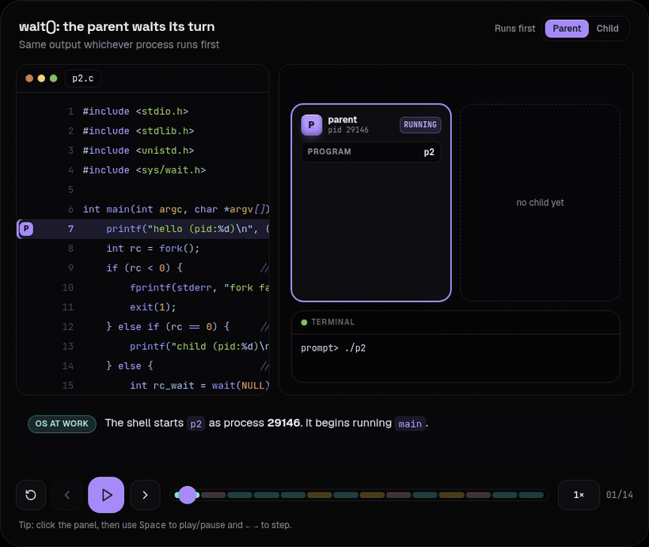
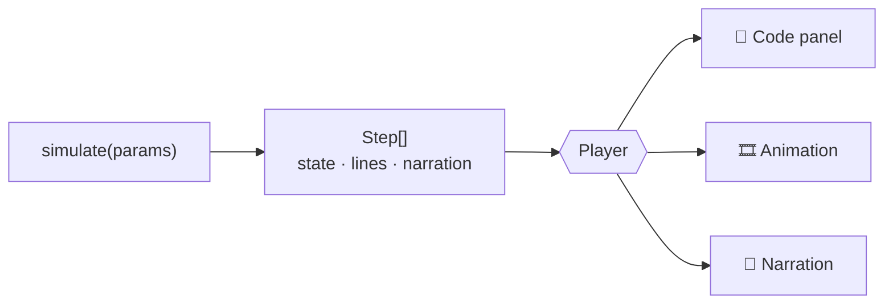

<p align="center">
  
</p>

<p align="center">
  <b>Learn operating systems by watching them work.</b><br/>
  Real code and a step-by-step animation of the machine, moving together line by line.
</p>

<p align="center">
  
  
  
  
  
  
</p>

<p align="center">
  <a href="#-quick-start">Quick start</a> ·
  <a href="#-features">Features</a> ·
  <a href="#-how-it-works">How it works</a> ·
  <a href="#-contributing">Contributing</a>
</p>

<p align="center">
  
</p>

## ✨ Overview

OS textbooks show code and describe what happens, but you have to *picture the machine yourself*. OSFLOW draws it for you.

- 🧾 **Real code:** the classic example programs from [*Operating Systems: Three Easy Pieces*](https://pages.cs.wisc.edu/~remzi/OSTEP/), with the running line highlighted.
- 🎞️ **Live animation:** CPU, memory, processes, files and disks react to every line. Play, pause, rewind or scrub.
- 💬 **Plain-English narration:** every step explains *what* happened and *why*.

<table>
  <tr>
    <td width="50%" align="center"><br/><sub><b>Two threads, one counter:</b> 3 + 3 = 4 when timing is unlucky</sub></td>
    <td width="50%" align="center"><br/><sub><b>fork() + wait():</b> parent <kbd>P</kbd> and child <kbd>C</kbd> tracked in the code</sub></td>
  </tr>
</table>

## 🧩 Features

| Feature | What you get |
|---|---|
| 🕹️ **Interactive demos** | 12 demos with options to try, such as *who runs first*, *unlucky timing* or *crash before fsync()* |
| 🛣️ **Learning roadmap** | `/roadmap`: all 36 chapters as a roadmap.sh-style map, with details and a guide to each stage |
| 🧠 **Mind map** | `/mindmap`: 41 concepts around 6 big ideas, each linked to its lesson |
| ✅ **Quizzes & progress** | A quiz ends every chapter; your progress shows on the home page and the roadmap |
| ⌨️ **Keyboard first** | <kbd>Space</kbd> play/pause · <kbd>←</kbd> <kbd>→</kbd> step · <kbd>R</kbd> restart |
| 🌗 **Themes & mobile** | Black dark mode and a light mode; works on phones; respects *reduce motion* |

## 🚀 Quick start

```bash
git clone https://github.com/ItWasYou-SAM/OSFlow.git
cd OSFlow
npm install
npm run dev        # http://localhost:3000
```

| Command | Description |
|---|---|
| `npm run dev` | Development server |
| `npm test` | Unit tests (simulators, player, content links) |
| `npm run build` | Static export to `out/` |
| `npm run preview` | Serve the static build |

> Requires Node.js 20+.

## ⚙️ How it works

Each demo is a **pure simulator** that returns snapshots. The player only moves through them, so rewind is free and every demo is unit-tested.



<details>
<summary><b>Project structure</b></summary>

```text
app/                 routes: /, /learn/[chapter], /roadmap, /mindmap
content/
  chapters/*.mdx     lesson text + <Demo id="…" />
  code/**            C / assembly shown in the code panel
  curriculum.ts      chapters and sections
  roadmap.ts         36 topics in 6 stages
  mindmap.ts         concept map
sims/                pure simulators + tests
components/
  player/  code/     SimulationPlayer, CodePanel
  demos/   viz/      demo components and shared visuals
  roadmap/ mindmap/  the two maps
```

</details>

## 🤝 Contributing

Adding a chapter takes five steps:

1. **Code:** add the example program to `content/code/<chapter>/`.
2. **Simulator:** write `sims/<chapter>/<demo>.ts` with `Recorder` (`lib/sim.ts`), plus a test.
3. **Visual:** build the demo in `components/demos/` and register it in `Demo.tsx`.
4. **Lesson:** write `content/chapters/<slug>.mdx`.
5. **Publish:** set `status: "ready"` in `content/curriculum.ts` and add the import in `app/learn/[chapter]/page.tsx`.

The roadmap and mind map update automatically, and `npm test` checks that every link still resolves.

## 🙏 Credits

- [**OSTEP**](https://pages.cs.wisc.edu/~remzi/OSTEP/) by Remzi & Andrea Arpaci-Dusseau: chapter order and example programs. All explanations in OSFLOW are original.
- [**xv6**](https://github.com/mit-pdos/xv6-public) (MIT): `struct proc` in *The Process*.

<p align="center"><sub>If OSFLOW helped you, consider giving it a ⭐</sub></p>
